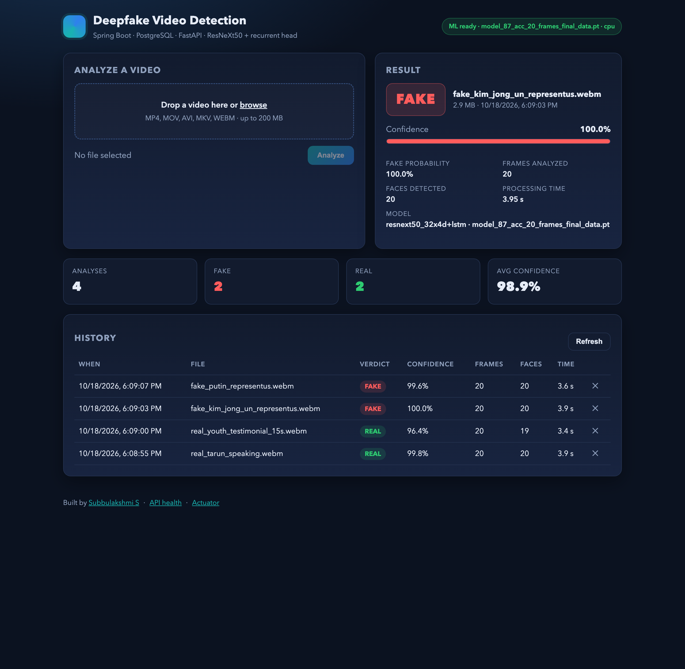

# Deepfake Video Detection — Full Stack Platform

Upload a video, get a **REAL / FAKE** verdict with confidence and frame statistics, and keep a searchable history.
A Spring Boot backend handles uploads, persistence (PostgreSQL) and the web UI; a Python FastAPI microservice runs a
**ResNeXt50_32x4d + recurrent (GRU/LSTM)** PyTorch model over face crops sampled from the video.

| Layer | Tech |
| --- | --- |
| Frontend | HTML, CSS, vanilla JavaScript (served by Spring Boot) |
| Backend | Java 17, Spring Boot 3, Spring Web, Spring Data JPA, RestClient |
| Database | PostgreSQL (`video_analysis` table) |
| ML service | Python 3.11, FastAPI, PyTorch, torchvision, OpenCV |
| Model | ResNeXt50_32x4d features per frame → GRU (or LSTM) → softmax over {FAKE, REAL} |

**Documentation:** [hosted docs site](https://claude.ai/artifact/B9LMNq44eLqoKfXthjjKga) · source in [docs/index.html](docs/index.html)
(enable GitHub Pages on `main` → `/docs` to serve it from this repository). Also see
[docs/architecture.md](docs/architecture.md) for the request flow and model details, and
[docs/DEMO.md](docs/DEMO.md) for a recorded end-to-end run with sample clips.



## Quick start (local)

Prerequisites: Java 17, Python 3.10+, PostgreSQL running on `localhost:5432`.

```bash
# 1. Database (once)
psql -h localhost -U postgres -c "CREATE ROLE deepfake LOGIN PASSWORD 'deepfake';"
psql -h localhost -U postgres -c "CREATE DATABASE deepfake_db OWNER deepfake;"

# 2. ML service
cd ml-service
python3 -m pip install -r requirements.txt
python3 -m scripts.download_weights --frames 20      # optional: pretrained checkpoint (see "Model weights")
uvicorn app.main:app --host 0.0.0.0 --port 8000

# 3. Backend + UI (new terminal)
cd backend
./mvnw spring-boot:run
# open http://localhost:8080
```

Environment variables (all optional): `DB_URL`, `DB_USER`, `DB_PASSWORD`, `ML_BASE_URL` (default `http://localhost:8000`),
`APP_STORAGE_DIR` (default `./uploads`), `PORT`; for the ML service `MODEL_PATH`, `WEIGHTS_DIR`, `SEQUENCE_LENGTH`,
`IMAGE_SIZE`, `DEVICE` (`auto`/`cpu`/`cuda`), `MAX_UPLOAD_MB`.

PostgreSQL older than 12? Start the backend with `SPRING_PROFILES_ACTIVE=legacypg`: it selects
`LegacyPostgresDialect`, which paginates with `LIMIT/OFFSET` instead of `FETCH FIRST ?`, a form old servers reject.
`./run-local.sh` detects the server version and sets the profile for you.

## Quick start (Docker)

```bash
docker compose up --build
# UI http://localhost:8080 · ML docs http://localhost:8000/docs
```

## REST API (backend, port 8080)

| Method | Path | Description |
| --- | --- | --- |
| `POST` | `/api/analyses` (multipart `file`) | Analyze a video → `201` with the stored analysis |
| `GET` | `/api/analyses?page=0&size=20` | History, newest first → `{ items, page, size, total }` |
| `GET` | `/api/analyses/{id}` | One analysis |
| `DELETE` | `/api/analyses/{id}` | Delete the analysis and its stored file |
| `GET` | `/api/analyses/stats` | `{ total, fake, real, errors, avgConfidence }` |
| `GET` | `/api/health` | Backend + ML service health |

Analysis JSON:

```json
{ "id": 1, "fileName": "clip.mp4", "sizeBytes": 183422, "verdict": "FAKE", "confidence": 0.93,
  "fakeProbability": 0.93, "framesAnalyzed": 20, "facesDetected": 18, "processingMs": 1840,
  "modelName": "resnext50_32x4d+lstm (model_87_acc_20_frames_final_data.pt)", "createdAt": "2026-10-18T12:30:00Z" }
```

ML service (port 8000): `GET /health`, `GET /model`, `POST /predict` (multipart `file`), interactive docs at `/docs`.

## Model weights

The service loads the first `*.pt` found in `ml-service/weights/` (or `MODEL_PATH`). Without a checkpoint it still
runs, using an ImageNet backbone with an untrained head, and reports `trained: false` so the UI shows a warning.

* **Pretrained (quickest):** `python -m scripts.download_weights --frames 20` fetches a public ResNeXt50 + LSTM
  checkpoint trained on FaceForensics++ / Celeb-DF / DFDC (from the GPL-3.0 project by Abhijit Jadhav). It is loaded
  through the `jadhav-lstm` architecture profile. Frame count is read from the file name.
* **Train your own GRU model:** arrange videos as `DATA/{train,val}/{real,fake}/*.mp4` and run
  `python -m scripts.train --data DATA --epochs 10 --seq-len 20 --out weights/deepfake_gru_20_frames.pt`.

## Tests

```bash
cd backend && ./mvnw test            # 18 Spring MockMvc / RestClient tests on H2 (ML client mocked)
cd ml-service && python -m pytest    # 5 FastAPI tests with a synthetic clip
```

## Project structure

```
backend/      Spring Boot app (REST API, JPA, static UI in src/main/resources/static)
ml-service/   FastAPI app (app/), training + utility scripts (scripts/), tests, weights/
docs/         architecture notes, sample clips, screenshots
docker-compose.yml
```

## Author

**Subbulakshmi S** · [GitHub](https://github.com/subbulakshmi0928-maker) · [Portfolio](https://subbulakshmi0928-maker.github.io/fullstack-portfolio/)
