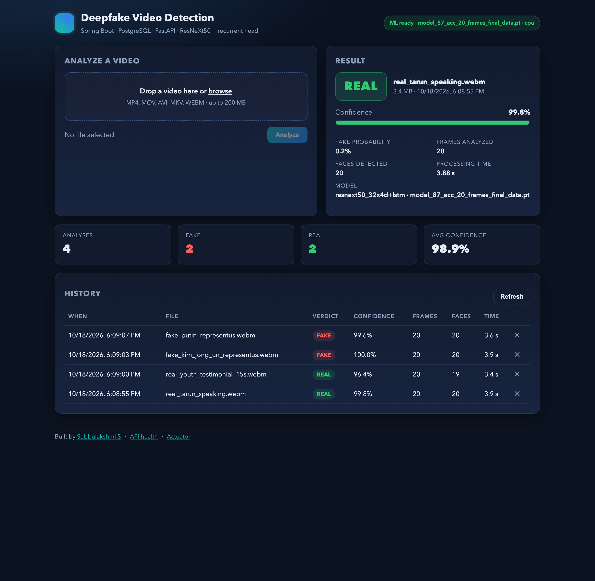
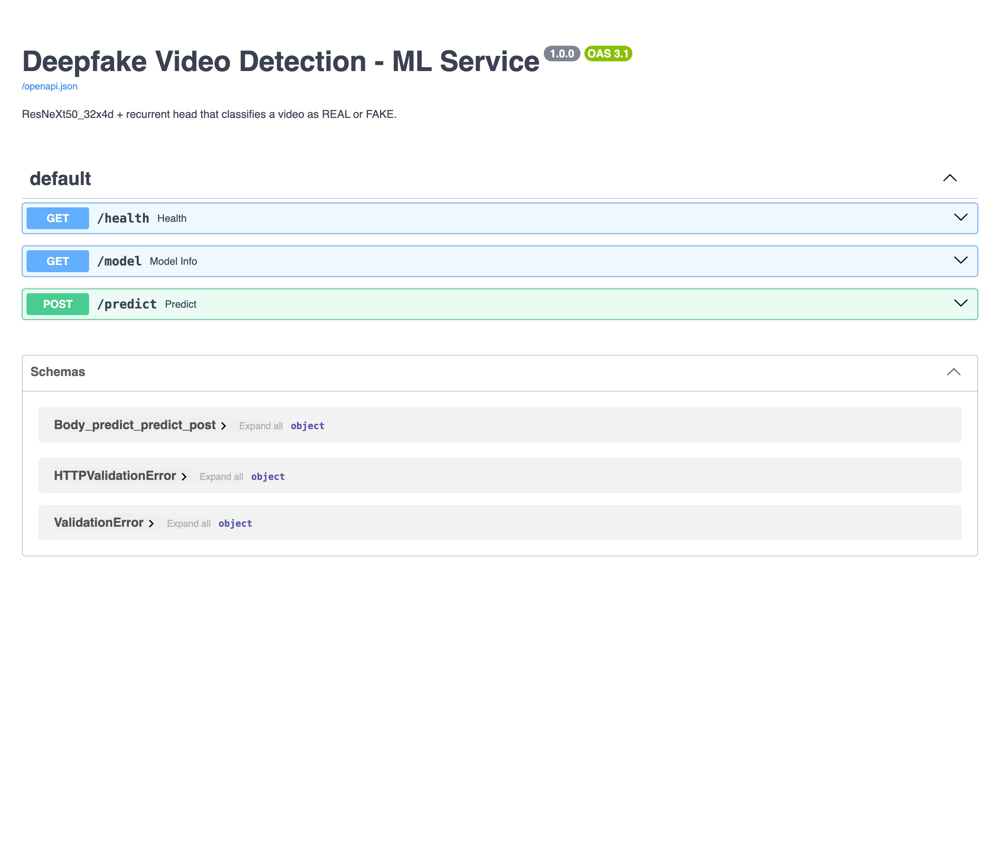

# Demo walkthrough

Everything below was run on a MacBook (Apple Silicon, CPU inference only) on 2026-10-18 with
`model_87_acc_20_frames_final_data.pt` loaded by the ML service and the backend talking to a local PostgreSQL.

## 1. Services

```
$ curl -s localhost:8000/health
{"status":"ok","model_loaded":true,"trained":true,"device":"cpu",
 "weights":"model_87_acc_20_frames_final_data.pt","sequence_length":20,"image_size":112}

$ curl -s localhost:8080/api/health
{"backend":"ok","mlService":{"status":"ok","model_loaded":true,"trained":true,...}}
```

## 2. Upload clips through the backend API

```
$ curl -F file=@docs/samples/fake_kim_jong_un_representus.webm localhost:8080/api/analyses
```

| Clip | HTTP | Verdict | Confidence | Frames | Faces | Time |
| --- | --- | --- | --- | --- | --- | --- |
| `real_tarun_speaking.webm` | 201 | **REAL** | 99.8 % | 20 | 20 | 3.9 s |
| `real_youth_testimonial_15s.webm` | 201 | **REAL** | 96.4 % | 20 | 19 | 3.4 s |
| `fake_kim_jong_un_representus.webm` | 201 | **FAKE** | 99.99 % | 20 | 20 | 3.9 s |
| `fake_putin_representus.webm` | 201 | **FAKE** | 99.6 % | 20 | 20 | 3.6 s |
| `README.md` (not a video) | 400 | — | `Unsupported file type '.md'; allowed: avi, mkv, mov, mp4, webm` | | | |

Stored model name on each row: `resnext50_32x4d+lstm · model_87_acc_20_frames_final_data.pt`.

## 3. History, stats and persistence

```
$ curl -s "localhost:8080/api/analyses/stats"
{"total":4,"fake":2,"real":2,"errors":0,"avgConfidence":0.9894}

$ psql -U deepfake -d deepfake_db -c "select id, verdict, confidence, original_file_name from video_analysis order by id"
 1 | REAL | 0.9977 | real_tarun_speaking.webm
 2 | REAL | 0.9638 | real_youth_testimonial_15s.webm
 3 | FAKE | 0.9999 | fake_kim_jong_un_representus.webm
 4 | FAKE | 0.9963 | fake_putin_representus.webm
```

`DELETE /api/analyses/{id}` removes the row and the stored file (verified: 204, then 404 on a second GET).

## 4. Web UI

| | |
| --- | --- |
|  |  |

The ML service also exposes interactive API docs at `http://localhost:8000/docs`:



## 5. How the preprocessing was chosen

The public checkpoint ships without preprocessing code. A small study over the four clips above compared frame
sampling (consecutive vs. spread), face-crop padding (0 / 15 % / 30 %), channel order (RGB vs. BGR) and how
per-frame scores are pooled. Only **consecutive frames from the first detected face + 15 % padding + RGB**
separated the clips (deepfakes ≥ 0.99 fake probability, real clips ≤ 0.15); the two FaceForensics-only
checkpoints (`model_90_…FF_data.pt`, `model_95_acc_40_frames_FF_data.pt`) did not separate them under any
setting, so the mixed-dataset 87 % checkpoint is the default. Treat this as a smoke test, not an evaluation.
